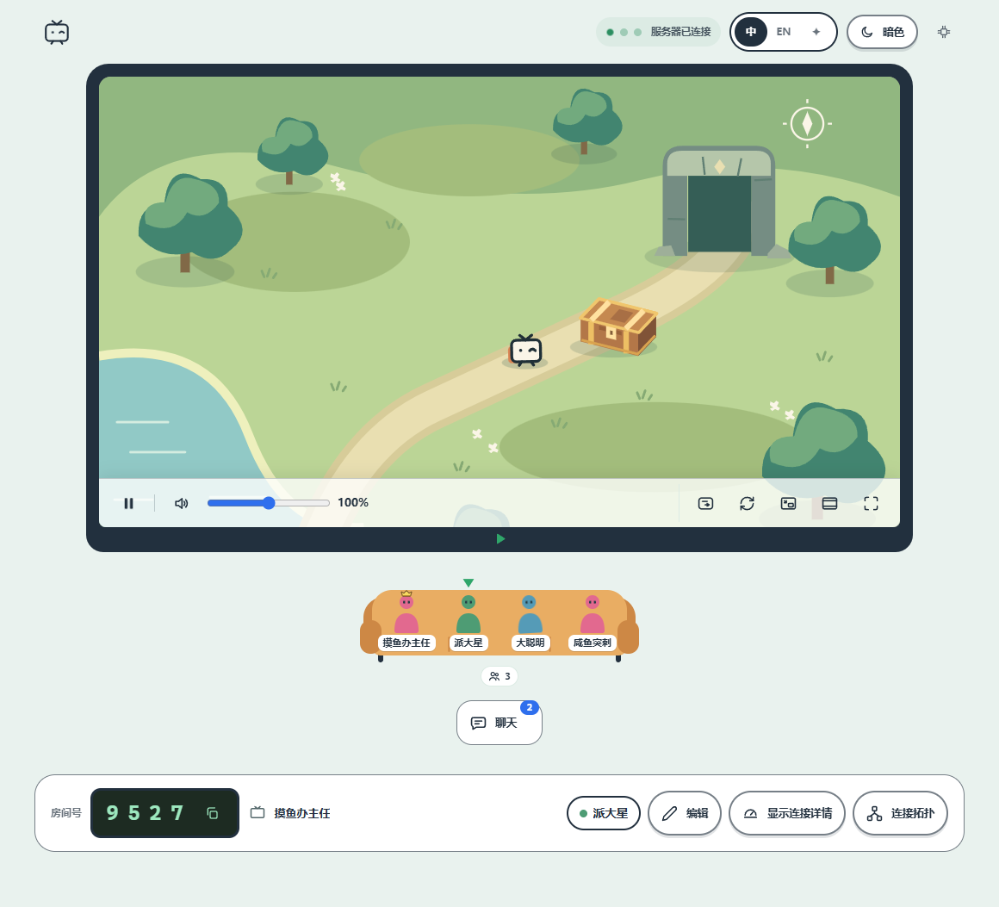

<p align="center"></p>
<h1 align="center">Piik</h1>
<p align="center"><strong>来，看点<br>好康的。</strong><br>私密屏幕共享，邀请最多 20 位朋友观看。</p>
<p align="center">
  <a href="./docs/guide/getting-started.zh-CN.md">快速开始</a> ·
  <a href="./docs/operations/self-hosting.zh-CN.md">自托管</a>
</p>
<p align="center">
  <a href="./LICENSE"></a>
  
  
</p>
<p align="center"><a href="./README.md">English</a> · 简体中文</p>

Piik 是一个免费开源的私密屏幕共享工具，适合游戏直播、一起看电影、展示绘画或分享照片。
选择画面，把邀请链接发给朋友，对方用浏览器即可观看。也支持自部署，搭建自己的 Piik 站点。

<details open>
<summary>客厅小剧场 · 展开 / 收起动画</summary>

<p align="center"></p>

</details>

[功能](#功能) · [开始使用](#开始使用) · [Windows 单文件版](#windows-单文件版) · [自行部署](#自行部署) · [参与贡献](#参与贡献)

## 功能

- **观看无须安装。** 朋友通过邀请链接，用电脑或手机浏览器加入。
- **用 Piik App 或已有 Piik 站点分享。** 支持屏幕、窗口、浏览器标签页和摄像头；可选来源与音频能力取决于平台。
- **优先直接连接。** 画面优先在设备之间传输（P2P），自建站点可启用媒体转发（SFU）自动兜底。
- **房间由你管理。** 支持邀请链接、房间号和可选的房间密码，一位房主、最多 20 位观众。
- **边看边聊。** 发送文字、和朋友互送表情，也可开启弹幕。
- **灵活的观看方式。** 支持深浅主题、播放控制、画中画和连接拓扑查看。
- **一个程序就能建站。** 网页、房间管理和可选的媒体转发打包在同一服务端程序中。

<p align="center">
  <picture>
    <source media="(prefers-color-scheme: dark)" srcset="./docs/assets/room-zh-dark.png">
    
  </picture><br>
  <sub>界面预览 · 示例房间与生成的游戏画面</sub>
</p>

## 开始使用

**观看分享：** 打开朋友发来的邀请链接。画面没有自动播放时，点击**播放**即可。

**分享画面：** 推荐使用 **Piik App**。

| 从这里开始 | 需要做什么 |
| --- | --- |
| [Piik App](./cmd/piik-app/README.zh-CN.md) | 解压并启动 Piik App，选择**公网邀请**，点击**进入 Piik**，创建临时房间。 |
| [部署自己的站点](./docs/operations/self-hosting.zh-CN.md) | 进阶使用：在 Linux x64 或 ARM64 服务器上部署 Piik Server、配置自己的域名，再用 Piik App 或浏览器连接。 |

<p align="center"></p>

1. 点击**开始分享**，选择要分享的画面和声音。
2. 点击**复制邀请链接**，发给朋友。分享期间保持标签页打开。

分享时还可以开启**麦克风**解说，在旁边的设置中选择设备、调整人声音量。

Piik 默认跟随系统语言，中文系统显示简体中文，其他语言显示英文。
顶部的 **中 / EN / ✦** 可切换中英文或体验纯视觉模式。
Piik App 提供本地房间、临时公网邀请和连接已有站点三种模式，分享期间需保持 App 运行。

下载以 **`piik-app`** 开头的 ZIP 压缩包，再按文件名中的平台标识选择：

| 文件名包含 | 适用平台 |
| --- | --- |
| `windows-amd64` | Windows x64 |
| `darwin-arm64` | Apple 芯片；原生采集需 macOS 13 及以上 |
| `darwin-amd64` | Intel Mac；原生采集需 macOS 13 及以上 |
| `linux-amd64` | Linux x64 |
| `linux-arm64` | Linux ARM64 |

[**完整使用教程 →**](./docs/guide/getting-started.zh-CN.md)

浏览器采集需要 HTTPS 或 `localhost`。目前主要测试 Windows 版 Piik App 和桌面浏览器分享。
macOS 和 Linux 版 Piik App 仍需更多实机测试，欢迎有设备的朋友试用并反馈问题。
Piik App 的公网邀请使用纯 P2P 连接，
在受限网络下可能无法连通。

## Windows 单文件版

`Piik.exe` 把整个 Piik App 放进一个便携文件：网页界面、原生屏幕采集与编码助手，
以及公网邀请隧道。无需安装。

1. 从本仓库最新的[发布版本](https://github.com/Lin-2352/piik/releases/latest)下载 `Piik.exe` 和 `Piik-Guide.md`。
2. 放到可写入的文件夹中，运行 `Piik.exe`，选择**本地房间**或**公网邀请**，再点击**开始分享**。
3. 设置、预设和上次的选择保存在 exe 旁边的 `piik-data` 文件夹，整个文件夹可以随身带走；
   助手程序首次运行时解压到旁边的 `runtime` 文件夹。

- **NVIDIA 硬件编码。** 电脑有 NVIDIA 显卡时，H.264、H.265 和 AV1 在其视频编码器上编码，
  且只使用这块显卡；游戏满载运行也不会拖垮直播。VP8 为 CPU 备用方案。
- **按观众限制帧率。** 无法解码 100 fps 以上画面的手机，从第一帧起自动降到一半帧率，
  电脑观众仍保持完整帧率。
- **已知限制。** 手机加入 2560 宽的完整画面时，开头可能卡住约两秒；使用 1080p 或 60 fps 可避免。

[**单文件版指南 →**](./standalone/Piik-Guide.md)（英文）

自行构建（Windows）：`pwsh scripts/build-standalone.ps1 -Version v1.10.0`
（需要 Go、Node 和 `runtime/` 中的助手程序，详见脚本开头的说明）。

## 自行部署

Piik Server 是一个内置网页界面的独立程序。
根据服务器架构下载 Linux x64 的 `piik-<revision>-runtime.tar.gz` 或 ARM64 的
`piik-<revision>-linux-arm64-runtime.tar.gz`，解压后运行：

```sh
./piik-server
```

打开 `http://localhost:8787` 即可在本机试用。对外提供服务时，
再配置域名、HTTPS 反向代理和 STUN 地址。房间数据保存在 SQLite 中。
也可以使用 [Docker Compose 部署](./docs/operations/self-hosting.zh-CN.md#使用-docker-compose)。

[**部署自己的站点 →**](./docs/operations/self-hosting.zh-CN.md) · [配置参考](./docs/standards/configuration.md) · [从源码运行](./docs/README.md#run-from-source)

## 参与贡献

欢迎反馈问题、参与翻译、改进文档或贡献代码。
从[社区参与方式](./CONTRIBUTING.md#ways-to-help)或
[翻译教程](./docs/guide/translating.zh-CN.md)开始，也可以从
[项目目录说明](./docs/standards/engineering.md#repository-layout)了解代码结构。

## 许可

Piik 自有代码采用 [MIT 许可](./LICENSE)，依赖保留各自的[许可与声明](./licenses/README.md)。
